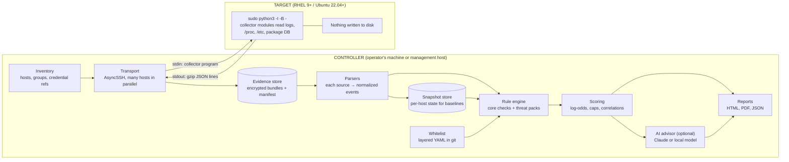

# Compromise Checker — Design

*Draft 2, 2026-10-25. NouriLoop LLC. Status: reviewed by John; all open questions
in section 19 decided. Nothing is built yet.*

"Compromise Checker" is a working name. The product name is undecided, so it
appears only in configuration, never in code (the same rule as Auditor).

---

## 1. Purpose and scope

The tool answers one question about a Linux server: **are there signs it has
been compromised, and how strongly do they point that way?**

It logs into each target over SSH, runs a read-only collector, brings the
evidence back, and analyses it on the operator's machine. It scores what it
finds, estimates a probability of compromise, writes a report, and uses an AI
advisor to explain findings, suggest whitelist changes, suggest further
collection, and advise on remediation.

**Supported targets**

| Family | Versions | Notes |
|---|---|---|
| Red Hat Enterprise Linux | 9.x, 10.x and later | Tested via Red Hat's free Developer Subscription |
| Rocky Linux, AlmaLinux | 9.x, 10.x and later | Tested and supported |
| Oracle Linux | 9.x, 10.x and later | Best effort: expected to work, not tested (Oracle's own kernel can differ); promoted if users ask |
| Ubuntu | 22.04 LTS and later | LTS releases are the test matrix; interim releases best-effort |

**Non-goals**

- Not an EDR or a real-time monitor. It takes point-in-time looks at a host
  and compares them with earlier looks.
- Not a remediation tool. It never changes a target. Remediation is advice in
  the report.
- Not a forensic imaging tool. Evidence is good enough to decide what to do
  next and to hand to an incident-response team, but it is not a disk or
  memory image.
- No Windows, macOS, or containers-as-targets in version 1. Container
  *hosts* are in scope (section 8.9).

---

## 2. Design principles

1. **The collector collects; the controller judges.** No analysis runs on the
   target. A compromised host cannot be trusted to judge itself, a small
   collector leaves a small footprint, and stored raw evidence can be
   re-scored later with new rules or a new whitelist without logging in
   again.
2. **Read-only, nothing written to the target's disk.** The collector arrives
   on stdin and leaves on stdout. Section 3.2 lists the traces that are
   unavoidable and says why we never remove them.
3. **Assume the target's tools may lie.** Read `/proc`, `/etc` and log files
   directly. Call system binaries only where there is no practical
   alternative (the journal's binary format, `rpm -Va`), and cross-check
   where we can.
4. **Everything is a change from a baseline.** "New user", "new sudo rights"
   and "new file in an odd place" only mean something against an earlier
   snapshot of the same host.
5. **Whitelists are code.** They live in version control, they carry a reason
   and an owner, and they can expire.
6. **Scores are explainable.** Every percentage in a report lists the findings
   that produced it and how much each contributed.
7. **The AI advises; it never decides.** The deterministic score is the
   record. The AI's commentary sits beside it, clearly labelled, and none of
   its suggestions take effect without a person approving them.
8. **Say what we could not see.** Missing logs, rotated history and absent
   auditd are reported as coverage gaps, not silently treated as "clean".
9. **Hygiene is not compromise.** An unattributed SSH key or a vulnerable
   package is a risk worth reporting, but it is not evidence that someone
   got in. The two are reported, and scored, separately.

---

## 3. Security and privacy policy

This section is the basis for the published policy that ships with the tool.
Several of these promises shape the architecture, which is why they come
first.

### 3.1 Authorization

- The tool is for systems the operator is authorized to assess. Every scan
  record names the operator, the controller host, the time, and the targets.
- There is no "discovery" mode that sweeps networks for hosts. Targets come
  only from an explicit inventory.

### 3.2 What happens on a target

**Promised:**
- The collector is **read-only**. It opens files for reading, lists
  directories, reads `/proc`, and runs a short allow-list of read-only
  commands (section 5.4). It never writes, renames, deletes, or changes
  permissions on anything.
- **Nothing is written to the target's disk by the tool.** The collector
  program is streamed to the Python interpreter's stdin and its output
  streams back over the SSH session. Python runs with `-I -B` (isolated, no
  bytecode files).
- It runs at the lowest CPU and I/O priority, with a time limit and per-source
  size limits, so it does not disturb production work.

**Unavoidable traces, disclosed rather than hidden:**
- The SSH login (sshd log, `wtmp`/`lastlog` or `wtmpdb`).
- The `sudo` entry, and sudo's own timestamp record under `/run` (memory, not
  disk) and, on first use by that account, its "lecture" marker.
- auditd records of the commands run, where auditd is configured to record
  them.

**Never done:** removing, editing, or suppressing any of those traces.
Changing logs on a system that may be compromised destroys evidence, and it
is exactly what an attacker does. Instead the analyzer recognises the tool's
own sessions (by connection time, source address and key fingerprint, which
the controller records) and leaves them out of the findings.

### 3.3 Credentials

- SSH keys are used through an SSH agent wherever possible. Key files and
  passwords are never stored by the tool in plain text.
- Passwords (SSH or sudo) come from an interactive prompt, the OS keyring, or
  the organization's secrets manager. They are held in memory for the run
  only, never written to logs, and never placed on a command line (where
  they would show in process lists and audit records). The sudo password
  travels on the session's stdin.
- **Host keys are always verified.** First contact with a host shows its key
  fingerprint and requires explicit acceptance. There is no option to turn
  verification off.
- The recommended setup is a dedicated scanner account, key-only, with a
  sudoers rule limited to the Python interpreter. The documentation says
  plainly that this rule is equivalent to root, and why that is acceptable
  for a read-only tool whose collector is published and hashed.

### 3.4 What is collected, and how it is treated

Evidence from a server contains personal and sensitive data: usernames, IP
addresses, email addresses in mail logs, URLs that may carry tokens, and
sometimes secrets typed into shell commands.

- **Minimum necessary.** Each collector module states what it reads and why.
  Collection of especially sensitive sources (full web access logs) is a
  per-organization setting.
- **Shell history.** Metadata is always collected: whether each history file
  exists, its size and times, whether it is linked to `/dev/null`, and whether
  start-up files switch history off (the anti-forensics checks need this).
  *Contents* are opt-in, chosen in `checker init`: when enabled, they are
  collected for root, service accounts and accounts with sudo rights; ordinary
  users' history only if separately enabled. Secret masking always applies,
  the report says when contents were collected, and contents reach the AI
  advisor only as short excerpts attached to a specific finding, under the
  redaction mode.
- **Secret scrubbing at source.** Before evidence leaves the target, the
  collector masks well-known secret patterns: private key blocks, `password=`
  style arguments, bearer tokens, and cloud access keys. The masking rules
  are published, and the report says that masking ran.
- **Encrypted at rest.** Evidence bundles are encrypted on the controller
  (age, to a key the organization holds). The database index keeps only
  identifiers, times, status, sizes and hashes readable; what a run collected,
  its connection details and its error text are encrypted to the same key.
- **Integrity.** Each bundle carries a SHA-256 hash, the collector's own hash
  and version, and a chain-of-custody record (who, when, from where, to
  where). Bundles are append-only once written.
- **Retention.** The default is 90 days, configurable. A `purge` command
  deletes bundles, snapshots and reports for a host or a date range. A host
  removed from the inventory has its data purged after the retention period.
- **Reports are confidential documents** and are marked as such. They contain
  enough detail to help an attacker, so they should be handled like the
  evidence.

### 3.5 The AI advisor

- **An explicit choice at setup.** `checker init` asks whether to enable it,
  explaining in a few lines what would be sent and to whom. A yes asks for
  the API key and sets redaction to *pseudonymize*; a no leaves everything
  else working, and reports carry a one-line note that the advisor exists.
  Unattended installs leave it off unless the configuration file turns it on.
  The tool works fully without it.
- **The organization's own API key** (or a local model; see section 11.5).
  NouriLoop LLC does not proxy, see, or store any of the data.
- **What is sent:** findings, their scores, short evidence excerpts, the
  relevant whitelist rules, and coverage information. Not whole log files,
  and never credentials.
- **Redaction modes**, chosen per organization:
  - *none* — excerpts are sent as collected (after secret scrubbing);
  - *pseudonymize* (default) — hostnames, IP addresses, usernames and email
    addresses are replaced with consistent tokens (`HOST-3`, `IP-17`,
    `USER-2`) and restored locally when the answer comes back;
  - *strict* — only finding types, counts and scores are sent.
- **Log text is untrusted.** Usernames, URLs, user agents and email subjects
  are controlled by whoever produced them, including an attacker. They are
  passed to the AI as delimited data, the AI has no tools that can reach a
  host, and nothing it says changes configuration or a score by itself.

### 3.6 What leaves the organization

Nothing, unless the AI advisor is enabled, in which case only what section
3.5 describes. There is no telemetry, usage reporting, or licence check that
phones home. Threat-pack updates are *pulled* by the operator and verified
before use (section 10.4).

### 3.7 The tool's own security

- The collector is a single, published, human-readable file. Its hash is
  recorded in every evidence bundle, so anyone can check what ran.
- Releases and threat packs are signed.
- Dependencies are pinned and kept short.
- `SECURITY.md` explains how to report a vulnerability (security@nouriloop.com),
  with a response commitment.

---

## 4. Architecture



**Why not Ansible.** Ansible copies its module payloads into a temporary
directory on the target, which breaks the nothing-on-disk promise, and it
brings a large dependency tree to do something small: connect, run one
program, read its output. AsyncSSH gives us parallelism, key and password
authentication, agent support, and full control of stdin and stdout in a few
hundred lines.

**Why Python on both sides.** Python is always present on the targets
(dnf on RHEL and many Ubuntu system tools depend on it), so the collector
needs no installation. Using Python on the controller too means the
collector's output format and the parsers can share one schema definition.

---

## 5. Collection protocol

### 5.1 One run, step by step

1. Controller opens an SSH session (key via agent, or password) with strict
   host-key checking.
2. It runs the interpreter in one of three ways, set per host:
   - `nopasswd` (recommended): `sudo -n -- python3 -I -B -` — `-n` makes sudo
     fail rather than ask, so no password is ever sent. This is exactly the
     command the scanner account's sudo rule and forced `authorized_keys`
     command allow (docs/scanner-account.md).
   - `password`: `sudo -k -S -p <unique prompt> -- python3 -I -B -c <bootstrap>`.
     The password is sent only after sudo's own prompt appears; the one-line
     bootstrap then prints a per-run ready marker, and the collector is sent
     only after it — proof that sudo accepted the password.
   - `root`: `python3 -I -B -`, no sudo.

   The collector lowers its own CPU and I/O priority as its first action, so
   nothing (`nice`, `ionice`) has to sit in front of the interpreter.
3. On stdin it sends the collector program, then end-of-file (in `password`
   mode, the password line first, as above). Python runs the program once
   stdin closes.
4. The collector writes a **gzip stream of JSON lines** to stdout: a manifest
   first (collector hash and version, host facts, clock, which modules ran),
   then one record per source chunk, then a trailer with counts and any
   errors. Diagnostics go to stderr.
5. The controller checks the stream as it arrives and writes it straight into
   an `age`-encrypted bundle (plaintext never touches the controller's disk),
   hashes it before and after encryption, and records the session details
   (times, both addresses, the key fingerprint that logged in) used later to
   filter out our own traces — for failed runs too, since they also leave
   traces.
6. The session closes. Nothing remains on the target.

### 5.2 Limits

- Overall time limit per host (default 10 minutes), per-module time limits.
- Per-source size caps (for example, web access logs capped and sampled with
  the cap reported as a coverage gap).
- A look-back window (default 30 days, or since the previous run plus
  overlap).

### 5.3 Clock

The manifest records the target's clock and the controller's clock at the
same moment. Timelines are corrected for the offset, and a large offset is
itself reported.

### 5.4 Read-only command allow-list

Where reading files directly is impractical, the collector may run these
and only these: `journalctl` (read options only), `rpm -Va` / `rpm -qa`,
`dpkg-query`, `ss` only as a cross-check against `/proc/net`, `systemctl show` /
`list-unit-files`, `sestatus` / `aa-status`, `iptables-save` / `nft list
ruleset` (read), `docker`/`podman` `ps --all` and `inspect` (read). Each
use is recorded in the manifest. File capabilities are read directly from
extended attributes with `os.getxattr`, so `getcap` is not needed.

### 5.5 Sources by distribution

| What | RHEL 9+ | Ubuntu 22.04+ |
|---|---|---|
| Authentication | `/var/log/secure`, journal | `/var/log/auth.log`, journal |
| System | `/var/log/messages`, journal | `/var/log/syslog`, journal |
| Kernel | `journalctl -k` | `journalctl -k`, `/var/log/kern.log` |
| Mail | `/var/log/maillog` | `/var/log/mail.log` |
| Audit | `/var/log/audit/audit.log` (auditd on by default) | same, if auditd is installed (not default) |
| Package history | dnf history database (SQLite, read with Python's `sqlite3`) | `/var/log/apt/history.log*`, `/var/log/dpkg.log*` |
| Package integrity | `rpm -Va` | `/var/lib/dpkg/info/*.md5sums`, checked directly |
| Logins | `wtmp`/`btmp`/`lastlog` (binary, parsed with `struct`) or `wtmpdb` where present | same |
| Web | `/var/log/httpd/`, `/var/log/nginx/` | `/var/log/apache2/`, `/var/log/nginx/` |
| PHP | `/var/log/php-fpm/` | `/var/log/php*-fpm.log*` |
| Mandatory access control | SELinux (`sestatus`, AVC denials in audit log) | AppArmor (`aa-status`, kernel log) |

---

## 6. Data model

- **Evidence bundle** — the raw collection from one run on one host:
  manifest, source chunks, trailer, hash, chain-of-custody record. Never
  modified.
- **Event** — one normalized log record: time (corrected), host, source,
  event type, and typed fields (user, source address, process, path,
  status…). Produced by parsers from a bundle; can be regenerated.
- **Snapshot** — the normalized state of a host at collection time: accounts,
  groups, sudo rules, authorized keys (by fingerprint), services and timers,
  cron entries, packages, listening sockets, kernel modules, watched-directory
  file inventories (path, owner, mode, size, times, hash for small
  executables), and configuration fingerprints (sshd, PAM, sudoers).
- **Finding** — a rule's output: rule id, title, category (*compromise
  indicator*, *hygiene*, or *exposure*), likelihood ratio, entities involved,
  links to the events and snapshot items that support it, and whether a
  whitelist rule suppressed it (suppressed findings are kept, and shown in an
  appendix).
- **Assessment** — the scored result of one run: prior, findings and their
  contributions, probability, band, coverage, and the AI commentary if any.

Storage: SQLite by default (single operator), PostgreSQL for teams. Bundles
are files; everything else is in the database.

---

## 7. Baselines

- The **first run** on a host produces a baseline snapshot and also reads back
  through whatever log history still exists. Its report says how many days
  of evidence it covers, per source.
- Each later run compares the new snapshot with the previous one (and with
  the oldest retained one, to catch slow changes) and analyses only the log
  window since the last run, with an overlap.
- An operator can **accept** a snapshot as the new baseline after reviewing a
  change (for example, after a planned upgrade). Acceptance is recorded with
  who and why.
- A baseline taken from a host that was already compromised would hide the
  compromise. The first-run report therefore runs every check that does not
  need a baseline (integrity, anti-forensics, live process checks, known-bad
  patterns, threat packs) and says clearly that change-based checks start
  from this point.

---

## 8. Checks

Each check has an id, the data it needs, whether it needs a baseline, its
category, and a default likelihood-ratio band (section 9). ★ marks checks
with the strongest default weight.

### 8.1 Kernel and system health

| Check | Source |
|---|---|
| Out-of-memory kills, especially of security or logging services | kernel log |
| Segfaults, repeated in network-facing services (a common sign of exploitation attempts) | kernel log, journal |
| Kernel oops/BUG, hung tasks, machine-check errors | kernel log |
| ★ Kernel taint changes; out-of-tree or unsigned module loads | `/proc/sys/kernel/tainted`, module list, kernel log |
| Core dumps of network-facing services | journal, coredump/apport directories |

### 8.2 Reboots

Each reboot is classified as **planned** (inside a configured maintenance
window, or triggered by unattended-upgrades or dnf-automatic), **operator**
(a shutdown or reboot command traceable to a sudo log entry), or **unclean**
(no shutdown record: crash or power loss). Unplanned and unclean reboots are
findings. Sources: journal boot list, `wtmp` reboot and shutdown records,
updater logs.

### 8.3 Accounts and authentication

| Check | Baseline |
|---|---|
| New local accounts; removed accounts | yes |
| ★ Any UID 0 account other than root; duplicate UIDs | no |
| ★ New sudo rights: sudoers and `sudoers.d` changes, new `NOPASSWD` | yes |
| ★ New membership of root-equivalent groups: `wheel`/`sudo`, `docker`, `lxd`, `disk`, plus `adm` (log access) | yes |
| Service accounts that gain a login shell or a password | yes |
| ★ New, changed or unattributed `authorized_keys` entries, for any user including root and service accounts | yes (unattributed: no) |
| ★ Failed logins followed by success from the same source | no |
| Logins from sources never seen before, at unusual hours, or as root directly | yes |
| `su` use; password changes | no |
| ★ `sshd_config` changes: root login, extra ports, key file locations, `AuthorizedKeysCommand` | yes |
| ★ PAM changes: `pam_exec` lines, unknown modules in the PAM module directory | yes |

### 8.4 Persistence

Cron (all users and system), `at` jobs, systemd timers, new system and user
units, `rc.local`, `/etc/profile.d`, shell start-up files, Ubuntu
`update-motd.d`, apt and dnf hooks, udev rules. ★ `/etc/ld.so.preload` and
`LD_PRELOAD` in any process environment.

### 8.5 System binary integrity

★ Package verification failures for system binaries (`ps`, `ls`, `ss`,
`sshd`, `login`, `sudo`, `su`, PAM modules). New SUID/SGID files, and SUID
files no package owns. File capabilities such as `cap_setuid`. Executables in
system directories that no package owns.

### 8.6 Files in unusual places

★ Executables in `/tmp`, `/var/tmp`, `/dev/shm`. Hidden directories with
deceptive names (`...`, `. `). Regular files under `/dev`. New script files
in web roots (web shells) and any script in an upload directory.
Timestomping (modification time much older than change time).

### 8.7 Live process state

★ Processes running from deleted files or from `memfd`. Processes running
from temporary directories. Names imitating kernel threads (`[kworker/…]`)
with a real executable behind them. Processes visible in `/proc` but hidden
from `ps`. ★ A shell whose stdin or stdout is a network socket (reverse
shell). Sustained high CPU with connections to mining-pool ports.

### 8.8 Network and data transfer

New listening ports. Outbound connections to new destinations or unusual
ports, including Tor. Changes to `/etc/hosts`, `resolv.conf`, or firewall
rules. Promiscuous interfaces. SSH port forwards and tunnels. ★ Web-tier
hosts connecting to internal directory services (SMB 445, LDAP 389/636,
Kerberos 88, WinRM 5985/5986). Processes other than the cloud agent
contacting the cloud metadata address (169.254.169.254).

Data transfer evidence on a host is weak on its own, so the tool combines
several weak signals: `scp`/`rsync`/`curl`/`wget` in audit records and shell
history, large archives created in temporary directories, network-counter
spikes from sysstat where installed, and outbound volume in web or proxy
logs. The report says when no strong source exists and the AI advisor
suggests one (egress firewall logging, auditd rules).

### 8.9 Outgoing mail

Baseline of recipient domains, relays, and sending local users. Findings:
new relays, mail sent by web-server users (`apache`, `www-data`, `nginx`),
sudden volume jumps or queue growth, new recipient domains in bulk, mail
configuration changes (new relayhost, open-relay settings).

### 8.10 Anti-forensics (★ all)

Gaps in the journal timeline. Truncated or missing log files that should
exist. Cleared `wtmp`/`btmp`. Shell history disabled or linked to
`/dev/null`. auditd, rsyslog or journald stopped, or audit rules changed.
SELinux switched to permissive or disabled; AppArmor profiles unloaded.
Security agents stopped (EDR, fail2ban). Clock jumps.

### 8.11 Software changes

Packages installed or removed outside maintenance windows. New repositories
or signing keys. Compilers or attack tools appearing on production hosts
(`nmap`, `masscan`, `socat`, `ncat`, `proxychains`). Global `pip`/`npm`
installs.

### 8.12 Web applications

★ Child processes of web workers (`php-fpm`, `httpd`, `apache2`, `nginx`,
`lsphp`, or anything running as a web-server user outside an interactive
login): shells, interpreters, download tools, and recon commands close
together. Live from `/proc`; historical only where auditd records process
execution, so the report flags that gap and recommends a rule file. Bursts
of 5xx responses or upstream errors from one source. Exploit strings in
access logs. Requests that succeed against newly appeared scripts.

### 8.13 Containers (on container hosts)

New containers, privileged containers, containers mounting the host's root
or the container runtime socket.

### 8.14 Exposure (from threat packs)

Vulnerable package versions, judged from vendor advisory data, not version
strings (distributions backport fixes without changing the upstream version
number). Services still running code from before a patch was installed.
Mitigation settings in place or missing. See section 10.

### 8.15 Optional enrichment (controller side)

IP reputation for login sources and outbound destinations, and hash lookups
for suspicious binaries. Only addresses and hashes leave the organization,
never files, and only when enabled.

---

## 9. Whitelists

### 9.1 Layers

`global` → `group` → `host`, merged in that order. A host file can add rules
or switch off a group rule (with a reason).

### 9.2 Rule shape

```yaml
# whitelist/groups/web.yaml
- id: deploy-after-login
  match:
    rule: ssh.login.new_source
    correlated_with:
      event: git.pull
      path: /var/www/*
      within: 30s
      same_user: true
  reason: "Deploys log in from wherever John happens to be, then pull at once."
  owner: john
  expires: never

- id: home-office
  match:
    rule: ssh.login.new_source
    source: 203.0.113.10
  reason: "Home office."
  owner: john
  expires: 2027-10-25
```

- Every rule needs a `reason` and an `owner`. `expires` is required; `never`
  must be written out.
- Suppressed findings are kept and listed in the report's appendix, with the
  rule that suppressed them.
- `checker whitelist test` re-scores stored evidence against a proposed
  change and shows what it would hide, before it is committed.
- Rules that have not matched anything in 90 days are reported as stale.

### 9.3 Quick start

An organization should get to a quiet, useful report on the second run. The
tool ships with default profiles (for example *web server*, *database
server*, *mail relay*) that whitelist the ordinary behaviour of each role,
and the AI advisor turns the first report's noise into a proposed whitelist
diff for the operator to review.

---

## 10. Threat packs

### 10.1 What a pack is

A dated, versioned, signed bundle that teaches the tool about one specific
threat, shipped separately from the core so it can be published within a day
of an advisory. A pack contains:

- **Exposure rules** — affected packages and fixed versions per distribution
  and release, taken from vendor advisory data.
- **Exposure window** — when the threat became active in the wild. A host
  that was exposed during the window gets a higher prior (section 11.2) and
  the report focuses its timeline on that window.
- **Detections** — rules over events and snapshots specific to the threat.
- **Mitigation checks** — settings that reduce exposure while a fix is pending.
- **Remediation text** — what to do if a host was exposed or shows signs.
- **References** — advisories and research used, with dates.

### 10.2 Example: PHP2Shell (first pack)

```yaml
id: php2shell-2026-10
title: "PHP2Shell — PHP remote code execution (CVE-2026-109618, CVE-2026-109619)"
version: 1
published: 2026-10-25
exposure:
  window_start: 2026-10-20T00:00Z     # technical details leaked
  first_seen_in_wild: 2026-10-21T07:43Z
  packages:
    upstream_fixed: ["8.2.35", "8.3.36", "8.4.27", "8.5.12"]
    vendor_data: [ubuntu-oval, rhel-oval, sury-ppa]
  stale_code: { service_glob: "php*-fpm", started_before: package_install_time }
mitigations:
  - id: upload-progress-off      # also covers CVE-2026-115560, unpatched at publication
    setting: session.upload_progress.enabled
    expect: "Off"
detections:
  - web.worker_child_process      # core rule, weight raised inside the window
  - php.memory_limit_burst        # "Allowed memory size … exhausted" clusters
  - php.fpm_worker_crash          # "child … exited on signal 11"
  - web.5xx_burst_from_source
  - web.multipart_post_to_root    # needs request size/content type in the log format
remediation:
  - Upgrade PHP to a fixed package and restart every PHP worker.
  - If the host was exposed during the window, treat secrets the PHP process
    could read as possibly disclosed (the memory-leak path can return them):
    rotate application keys, database passwords, API keys, TLS private keys,
    and invalidate sessions.
references:
  - https://www.cisa.gov/news-events/alerts/2026/10/21/critical-vulnerabilities-php-require-immediate-patching
  - https://sansec.io/research/php2shell
  - https://unit42.paloaltonetworks.com/cve-2026-109618-cve-2026-109619/
```

### 10.3 Lifecycle

Draft (the AI advisor can draft one from advisories) → human review →
signed release → operators pull it → it applies to stored evidence at once,
so the fleet can be checked against a new threat without a new collection
where the evidence already exists. Packs are retired, not deleted, so old
reports remain reproducible.

### 10.4 Distribution

- **Where:** a separate public repository (working name
  `compromise-checker-packs`), released on its own schedule under CC BY 4.0.
  Operators fetch with `checker packs pull`; air-gapped sites copy the files
  across by hand, since verification works offline.
- **Who signs:** one NouriLoop LLC minisign key. The private key stays
  offline (password manager plus an offline backup), never on a server or in
  CI. The public key ships inside the tool and is also published on
  nouriloop.com, so it can be checked from two independent places.
- **Contributions:** outside contributors open pull requests; NouriLoop LLC
  reviews and signs releases. One chain of trust for version 1.
- **Organization keys:** an organization may add its own public key to its
  local configuration and sign private packs (internal applications, threats
  it cannot share). Those packs are trusted only by that organization.
- The tool refuses unsigned packs and packs signed by a key it does not
  trust. Additional public signers can be considered later if a community
  grows.

---

## 11. Scoring

### 11.1 Model

Each finding carries a **likelihood ratio** (LR): how much more likely we are
to see it on a compromised host than on a clean one. Findings combine in
log-odds from a prior:

```
log-odds(compromised) = log-odds(prior) + Σ capped( log LR_i )
probability = 1 / (1 + e^(−log-odds))
```

Default LR bands (calibrated over time, section 11.5):

| Band | LR | Typical examples |
|---|---|---|
| Informational | 1 | Hygiene and exposure findings (scored separately, see 11.4) |
| Low | 1.5–2 | New listening port; package installed outside a window |
| Medium | 3–5 | Login from a new source; new cron entry; unplanned reboot |
| High | 10–30 | New UID 0 account; web worker spawning a shell; modified `sshd` binary |
| Critical | 50–200 | `ld.so.preload` entry; process hidden from `ps`; audit logging disabled plus cleared `wtmp` |

### 11.2 Prior

The default prior is low (2%) and configurable. Threat packs raise it for
hosts that were exposed during an active exploitation window, in proportion
to the pack's stated confidence and the length of exposure.

### 11.3 Avoiding double counting, and rewarding real chains

- **Family caps.** Findings of the same family (for example, many failed
  logins) contribute at most a capped amount, so volume alone cannot drive
  the score.
- **Correlation bonuses.** Sequences that match an attack chain within a time
  window earn an extra term: new account → sudo grant → outbound transfer;
  web worker child process → file in a temporary directory → new outbound
  connection.

Worked numbers: prior 2% (odds 0.020). One High finding at LR 20 → odds 0.41
→ **29%**. Add one Medium at LR 5 → odds 2.0 → **67%**.

### 11.4 What the report shows

- The **probability of compromise**, shown with a band (*Low / Elevated /
  High / Critical*) because the number is an estimate, not a measurement.
- The **contributors**: each finding's share of the log-odds, largest first.
- **Coverage**: which sources were missing or truncated. Low coverage does not
  lower the score, but it is stated next to it, because "no evidence" from a
  host with no logs is not reassurance.
- **Hygiene and exposure** in their own section with a separate risk rating,
  not mixed into the compromise probability.

### 11.5 Calibration

Starting LRs are expert estimates. They are tuned with labelled cases: clean
baseline runs from real fleets (false positives), and deliberately
compromised test hosts (section 15). Calibration results are published with
each release.

---

## 12. AI advisor

### 12.1 Roles

1. **Triage and explanation** — a plain-language account of what the
   findings mean together, which matter most, and what innocent explanations
   are plausible.
2. **Whitelist suggestions** — a YAML diff against the organization's
   whitelist, each entry with a proposed reason, for a person to accept or
   reject. Never applied automatically.
3. **Further collection** — suggestions limited to collector modules and
   options that exist (for example, "enable the auditd execve module and
   re-run on these hosts"), plus host configuration that would improve future
   coverage (log formats, audit rules).
4. **Remediation** — for findings above a threshold: containment, evidence
   preservation, eradication, recovery, and what to tell whom, scaled to the
   finding.
5. **Threat-pack drafting** — from advisories supplied by the operator, a
   draft pack for human review.

### 12.2 Interface

Structured outputs with fixed schemas for each role, so the report can render
them and the tool can validate them (unknown collector modules or malformed
whitelist rules are rejected before the operator sees them).

### 12.3 Guardrails

- The deterministic score is never changed by the AI.
- Inputs follow the redaction mode (section 3.5).
- Log-derived text is wrapped and labelled as untrusted data.
- The AI has no tools that reach a host or change configuration.
- Every AI section of a report names the model and the redaction mode used.

### 12.4 Models

Configurable. The default is the most capable current Claude model for
analysis and remediation, with a faster model available for routine triage
of quiet hosts.

### 12.5 Air-gapped use

A local model (for example through Ollama) can replace the API for
organizations that cannot send anything out. The report notes the lower
expected quality.

---

## 13. Reports

**Sections:** executive summary (probability, band, top three reasons, what
to do now) → hosts at a glance → per-host detail (contributors, findings with
evidence excerpts, timeline, coverage) → hygiene and exposure → AI advisor
(labelled) → appendix (suppressed findings and the rules that suppressed
them, collection manifest, hashes, chain of custody).

**Formats:** HTML (primary, self-contained file), PDF (for sending), JSON
(for SIEMs and tickets).

**Fleet view:** a summary across hosts, sorted by probability, with changes
since the previous run.

---

## 14. Interfaces

Command line first; a web interface later on top of the same store.

```
checker init                         # create config, keys, database
checker hosts add web01 --group web --user scanner --key agent
checker trust web01                  # first contact: show and accept host key
checker scan web01                   # collect + analyse + report
checker scan --group web --parallel 10
checker rescore --since 2026-10-01   # re-analyse stored evidence (new pack or whitelist)
checker report web01 --format pdf
checker baseline accept web01 --reason "Planned upgrade to 24.04"
checker whitelist test whitelist/groups/web.yaml
checker packs pull && checker packs list
checker advise web01                 # AI advisor on the latest assessment
checker purge --host web01 --before 2026-07-01
```

---

## 15. Technology

| Part | Choice | Why |
|---|---|---|
| Controller | Python 3.12+ | One language with the collector; shared schemas |
| Collector | Python 3.9-compatible, standard library only | Oldest `python3` in scope (RHEL 9); no installation |
| SSH | AsyncSSH | Parallel, agent and password auth, stdin/stdout control |
| Models | Pydantic | Shared, validated schemas for events, findings, AI output |
| Config | YAML (PyYAML, safe loader) | Readable whitelists and packs in git |
| Store | SQLite / PostgreSQL | Single operator / team |
| Encryption | age (pyrage) | Simple, audited, key held by the organization |
| Signing | minisign | Packs and releases |
| Reports | Jinja2 → HTML; WeasyPrint → PDF | Self-contained files |
| AI | Anthropic SDK; optional local model | Structured outputs |

---

## 16. Testing

- **Parsers:** fixture logs from each supported release, including rotated and
  compressed files, odd formats, and hostile content (injection strings in
  usernames and URLs).
- **Read-only guarantee:** a test that runs the collector on a test host
  under auditd file-write rules and fails if anything outside the
  disclosed traces changed.
- **Distribution matrix:** throwaway cloud VMs for RHEL, Rocky Linux and
  AlmaLinux 9 and 10, and Ubuntu 22.04, 24.04 and 26.04, created and
  destroyed per test run. CentOS Stream is not claimed.
- **Attack scenarios:** scripted, reversible compromise behaviours on
  throwaway VMs (new UID 0 account, `authorized_keys` backdoor, cron and
  systemd persistence, `ld.so.preload`, a web shell spawning a shell,
  history wiping, auditd stopped). Each scenario has an expected set of
  findings and a minimum score.
- **Clean baselines:** real, quiet servers (with permission) to measure false
  positives.
- **Golden reports:** stored evidence plus expected report output, so scoring
  changes show up as diffs.

---

## 17. Worked example: one production check, done by hand

On 2026-10-25 we checked a small production web server (Ubuntu 24.04, nginx,
PHP-FPM 8.4, two Symfony applications) for PHP2Shell by hand. The steps are
what the tool will automate, and the false alarms are what its whitelist and
correlation rules must handle. Addresses below are replaced with
documentation addresses.

| Step | What we found | How the tool should represent it |
|---|---|---|
| Package and service check | PHP 8.4.27 (fixed) installed 2026-10-23 18:20 UTC; php-fpm restarted 26 s later | Exposure: fixed. Stale-code check: passed. Exposure window ≈ 2.5 days → raised prior for this run |
| Mitigation check | `session.upload_progress.enabled` was on | Exposure finding (CVE-2026-115560); cleared once turned off |
| Web-worker processes, temp files, git status of app trees, new scripts | Nothing unexpected; all changed PHP files tracked by git | No findings; coverage notes that historical process data needs auditd |
| php-fpm crashes, kernel segfaults/OOM, memory-limit errors, 5xx | None in the window | No findings — strong evidence against a successful attempt |
| POST requests | Scanner noise (WordPress paths, old phpunit exploit, cgi-bin traversal, GraphQL probes, ~240 POSTs to `/` and `/index.php`, all answered 3xx/4xx, mostly from one /24) | Built-in "internet background noise" classifier: requests to paths the app doesn't have, answered 3xx/4xx, no errors → informational |
| SSH sources | Two unfamiliar addresses: the old hosting server (cutover copy, with the `cutover` key) and a mobile network (a deploy: login, then `git pull` two seconds later) | `ssh.login.new_source` findings, explained by the `deploy-after-login` correlation and a whitelist entry for the decommissioned host |
| Authorized keys | Two unlabelled keys never used to log in, copied from the cloud provider profile into root and then the admin user | Hygiene: unattributed credential (not a compromise indicator); recommendation to remove |
| Result | No signs of compromise | Probability stays near the raised prior, band *Low*, with hygiene and exposure items listed |

Lessons that changed this design:

1. A loose text search for "Accepted" also matched `PubkeyAcceptedAlgorithms`
   warnings. Parsers must understand each log format; no grep-style rules.
2. Linking a login to the deploy that followed it turned an "unknown address"
   into a known event in one step. Correlation belongs in the engine, not in
   the operator's head.
3. The admin account could not read the logs without sudo, so a scanner
   account needs sudo by design (section 3.3).
4. Hygiene findings (unlabelled keys) were the most useful outcome of a
   "clean" check. They need their own section in the report.

---

## 18. Delivery phases

| Phase | Delivers |
|---|---|
| 0 | Repository, policy text, collector skeleton, transport, evidence bundles, read-only test |
| 1 | Parsers for both families, snapshots and baselines, core checks 8.1–8.7, HTML report |
| 2 | Whitelist layers and tooling, scoring and calibration harness, checks 8.8–8.13 |
| 3 | AI advisor (all roles), redaction modes |
| 4 | Threat packs: format, signing, PHP2Shell pack, pack drafting |
| 5 | Fleet view, PDF/JSON, PostgreSQL, web interface |

---

## 19. Decisions (formerly open questions)

1. ~~Product name.~~ **Decided 2026-10-25:** "Compromise Checker" stays the working
   title; the final name is chosen before the first public release, with
   trademark, domain, package-name and look-alike checks done for each candidate.
2. ~~Licence.~~ **Decided 2026-10-25:** AGPL-3.0 for the tool, CC BY 4.0 for
   threat packs. NouriLoop LLC holds the copyright, so a customer who cannot
   accept AGPL can be offered a separate licence; that only stays possible if
   outside code contributions come with a contributor agreement (decide when
   the first one arrives).
3. ~~AI advisor default.~~ **Decided 2026-10-25:** no default; an explicit choice
   in `checker init` (section 3.5). Off for unattended installs unless configured.
4. ~~Shell history.~~ **Decided 2026-10-25:** metadata always; contents opt-in
   in `checker init`, privileged accounts only by default (section 3.4).
5. ~~RHEL rebuilds.~~ **Decided 2026-10-25:** RHEL, Rocky Linux and AlmaLinux
   tested and supported; Oracle Linux best effort; CentOS Stream not claimed.
6. ~~Threat-pack publishing and signing.~~ **Decided 2026-10-25:** separate public
   packs repository, one offline NouriLoop LLC signing key, optional
   organization keys for private packs (section 10.4).
