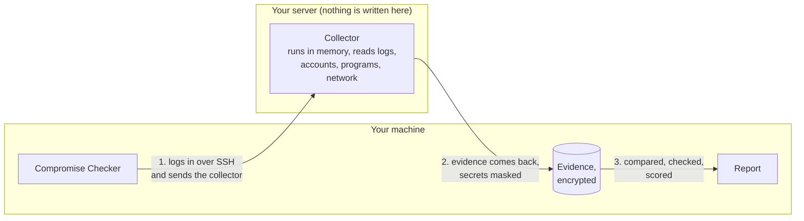
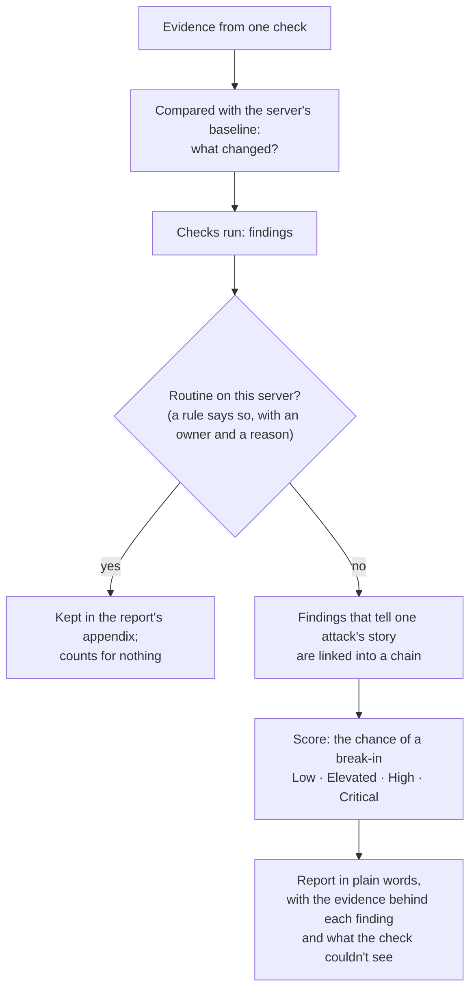
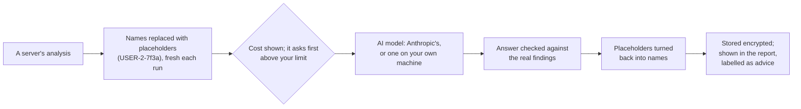

# Compromise Checker

Checks your Linux servers for signs of a break-in, and tells you what it found
in plain words.


*A demo fleet of throwaway servers, attacked on purpose. Real results from
this tool, with addresses replaced.*

Compromise Checker logs in to each server over SSH and reads the evidence:
logs, accounts, scheduled jobs, running programs, network connections and
more. It brings that back to your own machine and works out how likely it is
that the server has been broken into. **It writes nothing to the server.** Each server
gets a plain answer, the evidence behind every finding, and what to do next.

It is built for small organizations that can't afford commercial security
products, and it works from a web page: no command line needed. Open source
under the AGPL, from NouriLoop LLC.

**Status:** in development. Everything described here works today; the first
signed release is being prepared.

## What you need

| | |
| --- | --- |
| **Servers to check** | Red Hat Enterprise Linux 9 or later (tested on Rocky Linux and AlmaLinux), or Ubuntu 22.04 or later. No software is installed on them. Each needs a login account that can use sudo: [how to set one up](docs/scanner-account.md). |
| **A machine for the tool** | One of its own, since it holds keys that act as an administrator on every server it checks. x86, running Ubuntu 24.04 or 26.04 or Rocky Linux 9 or 10: [installing](docs/install.md). Developers can run it from source on any machine with Python 3.12 or later. |

## How a check works



1. **Log in.** The tool connects over SSH, with a key, your SSH agent or a
   password, and checks the server's identity against the key you approved.
2. **Collect.** It streams a small program to the server's own Python, which
   runs in memory, reads the evidence and sends it straight back. Nothing is
   saved on the server. Passwords, keys and the private part of email
   addresses are masked before anything leaves it.
3. **Keep.** The evidence is stored on your machine, encrypted. Its hashes
   and a record of who handled it and when are kept with it, so it can be
   relied on later, in an inquiry or in court.
4. **Compare.** Each server is compared with its own past: the first check is
   its baseline, and every check after that shows what changed, such as new
   accounts, sudo rules, SSH keys, start-up jobs or open ports.
5. **Decide.** The checks run, findings that tell one attack's story are
   linked together, and the server gets a score and a report.

## From evidence to an answer



| The server scores | Which means |
| --- | --- |
| **Low** | No strong signs. A fresh server scores 5.8%. |
| **Elevated** | Something needs an explanation. |
| **High** | Likely broken into. Look today. |
| **Critical** | Strong signs of a break-in. Act on this now. |

A clean result is an estimate, not proof: the report also lists what the
check could not see, such as logs that were missing or audit records that
were off, so you know how much to trust it.

**What it looks for** ([checks](docs/checks.md)):

- changes to accounts and logins, a second root account, backdoor SSH keys;
- programs set to start by themselves: cron, systemd, shell start-up files,
  preloaded libraries;
- system programs that have been altered, and files in odd places;
- suspicious running programs, reverse shells and tunnels;
- logging that stopped or was wiped;
- software and package sources that appeared;
- bursts of mail from a web server, web shells, and containers that reach
  the host.

Signed **threat packs** teach it about new attacks without a new release of
the tool ([packs](docs/packs.md)).

**What's routine stays quiet.** A rule can mark a finding as normal on a
server, with a reason, an owner and an expiry date. Profiles for web,
database, mail and build servers cover what such servers ordinarily do, and
a planned maintenance window keeps a reboot out of the score
([whitelists](docs/whitelists.md)).

## The AI advisor (optional)

Off unless you turn it on. When asked, it explains a server's result in
plain language, says what would settle it, proposes rules for findings that
are routine, suggests settings that would let the next check see more, and
advises what to do about a break-in, in order: keep the evidence first, then
contain, clean up and recover.

**It only advises. Nothing it says runs.** Nothing is sent until you have
seen the likely cost, and it asks first when that cost is above a limit you
set.



Account names, host names, email and IP addresses and SSH key fingerprints
are replaced with placeholders before anything is sent, or you can send only
counts and kinds of finding. A model on your own machine (Ollama, llama.cpp,
vLLM) costs nothing and sends nothing anywhere, though its answers are
weaker. Every answer is checked against the real case before it is shown,
and the report labels it as advice, apart from the findings
([the advisor](docs/advisor.md)).

## Getting started

**From a web page.** Once the first release is out, install the tool on its
own machine with the one line from the release's install page
([installing](docs/install.md)). It gives you
a link to create your account. Add your servers, press **Check**, and the
servers appear in the order to deal with them. Checks can run every day by
themselves ([the web interface](docs/web.md)). One thing is set up once at
the command line: a short summary can go to mail or a webhook when a server
needs a look ([scheduling](docs/scheduling.md)).

**From the command line.** The tool isn't on PyPI, the public Python
package index, so install it from a release's install page as above, or,
until there is one, run it from this repository on a machine with Python 3.12 or later:

```
git clone https://github.com/john-c-houser-tech/compromise-checker.git
cd compromise-checker
python3 -m venv .venv && . .venv/bin/activate
pip install -e ".[web]"       # [web] adds the web page; plain "." for the terminal only
checker init                    # makes the evidence key, database and settings
checker hosts add web01 --address web01.example.org --user scanner --auth agent --sudo nopasswd
checker run --all               # collect, analyse, report, in one pass
checker report --open           # read the report in your browser
checker schedule install --at 03:00   # the same, every day
```

The main commands and their options are described in
[docs/commands.md](docs/commands.md); `checker --help` lists them all.

## How we know it works

- **It writes nothing.** On throwaway servers running seven Linux images
  (Ubuntu 22.04, 24.04 and 26.04; Rocky Linux 9 and 10; AlmaLinux 9 and 10),
  the audit system recorded every write made during the tool's session. The
  collector made none. Every other write came from the system's own login
  machinery and matched the traces the
  [policy](docs/security-and-privacy-policy.md) discloses
  ([proof](tests/integration/readonly_proof.py); results in the
  [Phase 1](plans/phase1-build-plan-2026-10-26.md) and
  [Phase 2](plans/phase2-build-plan-2026-10-28.md) plans).
- **It catches break-ins.** Thirty scripted compromises on Ubuntu 24.04 and
  Rocky Linux 9, from a second root account and a backdoor key to a web shell
  and a container that mounts the host's disk, each produced its finding at
  its band or above. Both attack chains were recognised: a new account given
  sudo and used, and a web shell answering, then starting a shell
  ([proof](tests/integration/detection_proof.py)).
- **It stays calm on clean servers.** Fresh servers on all seven images score
  Low (5.8%), with the proof's own setup whitelisted and the `base` profile;
  the compromised ones score Critical
  ([calibration](docs/scoring.md#calibration)).
- **One gap.** Red Hat Enterprise Linux itself hasn't been tested. Rocky
  Linux and AlmaLinux, built from the same sources, stand in for it. Red
  Hat's own subscription and Insights services may raise findings no run has
  seen yet.

## Learn more

| | |
| --- | --- |
| [Security and privacy policy](docs/security-and-privacy-policy.md) | What the tool does on your servers and with your data. |
| [SECURITY.md](SECURITY.md) | Reporting a vulnerability. |
| [Installing](docs/install.md) · [Setting up a server](docs/scanner-account.md) · [The web interface](docs/web.md) | Getting it running. |
| [Commands](docs/commands.md) | Every command and option. |
| [Checks](docs/checks.md) · [Scoring](docs/scoring.md) · [Whitelists](docs/whitelists.md) · [Threat packs](docs/packs.md) · [The AI advisor](docs/advisor.md) | How it decides. |
| [Reports](docs/report.md) · [Scheduling](docs/scheduling.md) · [Retention](docs/retention.md) | Day to day. |
| [DESIGN.md](DESIGN.md) · [plans/](plans/) | The architecture, the decisions made so far, and the build plan for each phase. |

## Development

Runs on Python 3.12 or later on the machine that does the checking.

```
python3 -m venv .venv && . .venv/bin/activate
pip install -e ".[dev]"
ruff check . && ruff format --check . && pytest
```

The collector (`checker/collector/collector.py`) must stay Python 3.9
compatible and standard-library only, because it runs on the servers' own
Python; CI runs its tests with the system `python3` of each supported
distribution.

Golden reports (`tests/golden/`) pin the findings and score of real analyses
of throwaway servers. After a deliberate change to checks or scoring,
`python scripts/update_golden.py` rewrites them and shows what moved
([scoring](docs/scoring.md#golden-reports)).

## Licence

AGPL-3.0 (see [LICENSE](LICENSE)). Threat packs are published separately, in
[compromise-checker-packs](https://github.com/john-c-houser-tech/compromise-checker-packs),
under CC BY 4.0.

Provided as is, without warranty. Findings are estimates, and a clean report
is not proof that a server is clean; see section 14 of the
[security and privacy policy](docs/security-and-privacy-policy.md).
