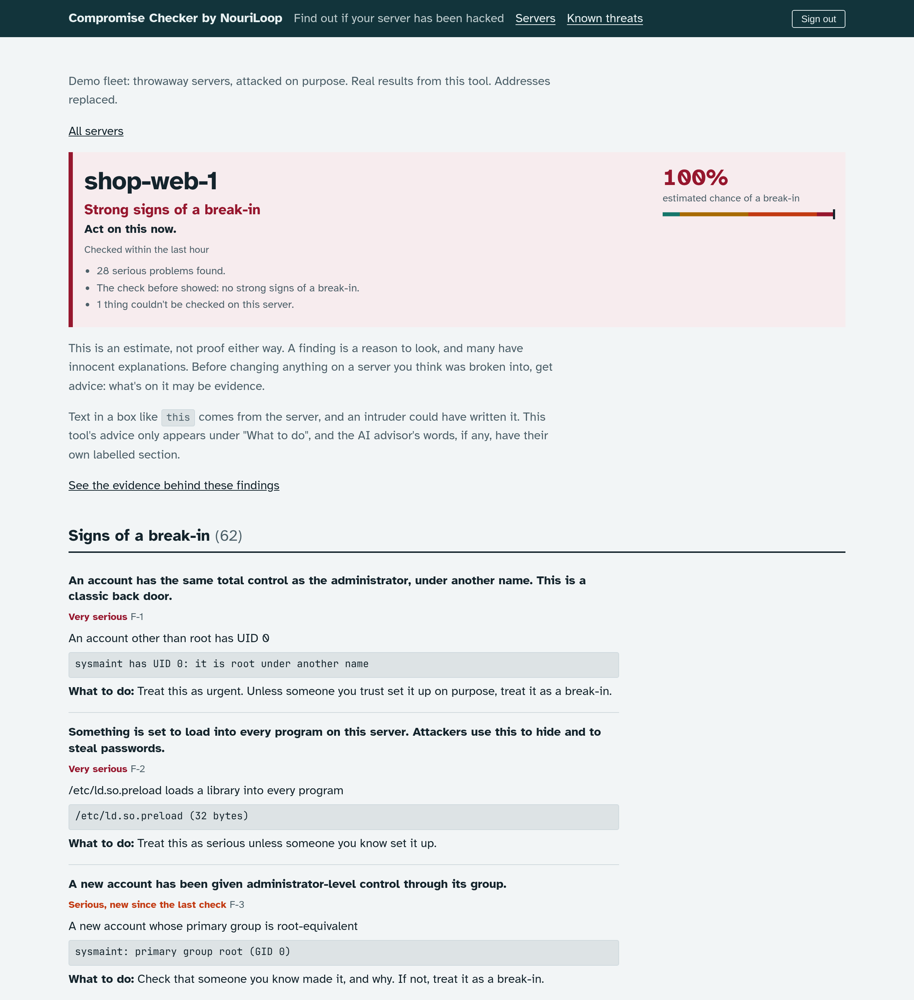
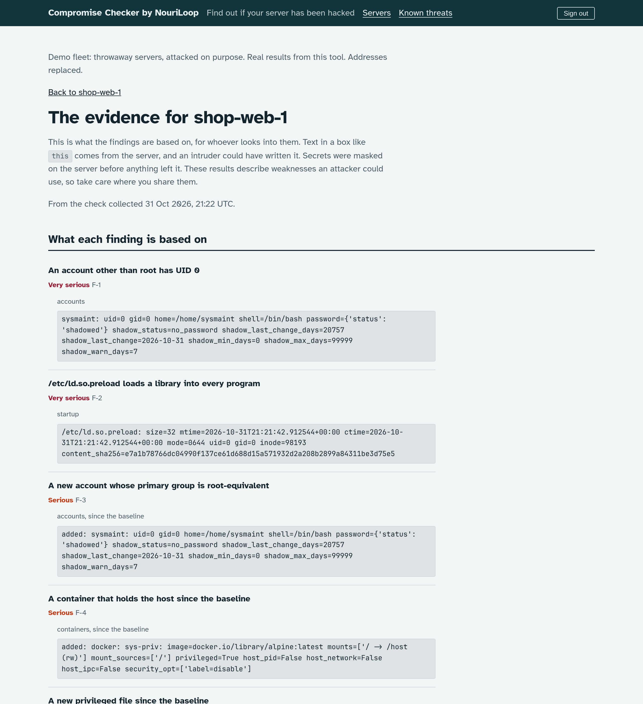
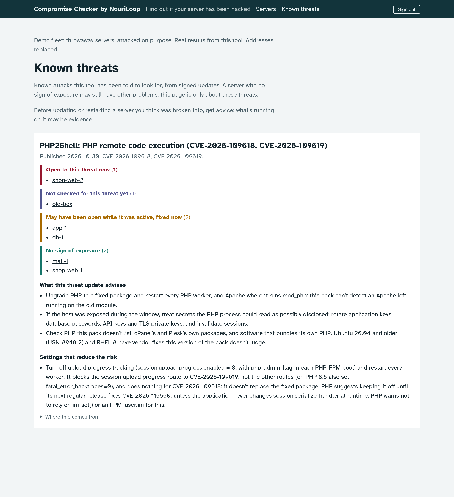

# The web interface

For people who won't use a command line. Install the extra and start it:

    pip install -e '.[web]'
    checker web

The first time, it prints a link that works once, for an hour. Open it and create your
account. Each restart replaces the link until an account exists. After that, sign in at the
address it prints.

So far it shows the fleet, most worrying first ([the fleet at a glance](report.md)). A server
reads as having no strong signs only if its score is Low and nothing else is wrong: an open
threat, serious problems, warnings from the check before, missing logs or a stale result all
take that away. It only reads: the evidence store is opened read-only, and pages collect, analyse and change nothing.

Each server has its own page, with what was found in plain words, and an evidence page for
whoever looks into it: the excerpts behind each finding, what happened in order, and the
collection's fingerprints and chain of custody. Pages show what is stored, and if part of a
check's details isn't stored they say so. Text from a server is boxed apart, since an intruder
could have written it.

Each server's page, and the evidence behind it, from a demo fleet of throwaway servers attacked on
purpose. These are real results from this tool, with addresses replaced:

To take them again: `tests/integration/demo_fleet.py` makes the fleet (about 3 cents of Linode time),
and `tests/integration/screenshots.py` photographs it. Every page is scrubbed of public addresses on
its way to the browser, and the run stops if any survive.

## Where it listens

By default, on this machine only (`127.0.0.1:8088`). Anyone with an account on this machine
can reach that address, which is why it asks for a login even there.

- **Behind a proxy on this machine** that provides https (Caddy, nginx):
  `checker web --public-url https://checker.example`. Only that address is accepted, and cookies
  are sent only over https. The proxy must add the client's address as the last entry of
  `X-Forwarded-For`, which Caddy and a normal nginx setup do, and should buffer request bodies.
- **From other machines, without a proxy:**
  `checker web --bind 0.0.0.0:443 --tls-cert CERT --tls-key KEY --public-url https://checker.example`.
  It refuses to listen beyond this machine without TLS, and refuses an http address for another
  machine, since logins and evidence would cross the network unencrypted.

## What it keeps

`web.db` in the checker's home, owner-only: accounts with hashed passwords, sessions, failed
logins for the last 15 minutes with their usernames and addresses, and the activity record below. No evidence is ever copied
there. `keys/web-secret.txt` signs sessions; deleting it signs everyone out. Evidence is decrypted
in memory for each page, with the same key the command line uses, and pages tell browsers not to
keep them. There is no access log; only errors in the tool itself go to its standard error.

## The activity record

The Activity page lists who signed in and out, who viewed which server's results and evidence, and each
action taken from these pages, with when and from which address. It's permanent and append-only, in the
tool's own words, and holds no evidence. It tells you what happened; anyone with full control of this
machine could still alter it, so it isn't protection against that. If an action can't be recorded, it
doesn't happen.

Anything that changes what later findings mean, or removes data, asks for your password again, even
when you're signed in.

## How it protects you

- **Passwords:** at least 12 characters, not common, not all digits, not like the username. Five
  failed logins for a name from one address, or twenty from one address, stop further tries from
  there for 15 minutes, even with the right password. Without a proxy, everyone on this machine
  counts as one address, so another local user could lock you out for that long. If you lose your
  only password, delete `web.db` and start again: the next start gives a new setup link.
- **Host text is treated as hostile.** A compromised server can put anything in its logs, and that
  text reaches a signed-in browser. Everything printed is escaped, invisible characters are shown,
  and the content security policy allows no scripts at all and nothing from other sites.
- **Sessions** last 8 hours or until the browser closes. Cookies can't be read by scripts or sent
  from other sites.
- **Nothing is fetched from elsewhere:** no analytics or content delivery networks. The font,
  Atkinson Hyperlegible from the Braille Institute, ships with the tool under the SIL Open Font
  License (`checker/web/static/fonts/OFL.txt`).

The name shown can be changed with the environment variable `CHECKER_PRODUCT_NAME`.
